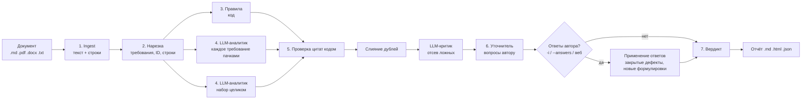
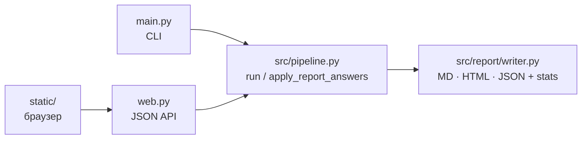

# Архитектура

## Конвейер

## Два интерфейса, одно ядро

- `main.py` и `web.py` вызывают одни и те же функции `run()` и `apply_report_answers()`. Своей логики проверки в веб-слое нет.
- Показатели дашборда (индекс качества, статусы требований, противоречия) считает `src/report/stats.py`.
  Эти же цифры лежат в JSON-отчёте CLI (`stats`) и в вердикте, поэтому CLI и веб не расходятся.
- Веб-слой: `ThreadingHTTPServer` из стандартной библиотеки, задача анализа — в отдельном потоке,
  прогресс этапов берётся из того же колбэка, что печатает этапы в CLI. Браузер опрашивает `/api/jobs/<id>` раз в секунду.
- Безопасность: текст документа выводится только через `textContent`, строгий CSP, защита от выхода из `static/`,
  лимит загрузки 10 МБ, сервер по умолчанию слушает только `127.0.0.1`.

## Роли (агенты) и где они в коде

| Роль | Что делает | Код | LLM? |
| :--- | :--- | :--- | :--- |
| Чтец | Извлекает текст; для PDF восстанавливает заголовки (по размеру шрифта) и таблицы | `src/ingest.py` | нет |
| Нарезчик | Делит на требования: пункты, абзацы, строки таблиц; сохраняет ID документа и номера строк; отделяет служебные блоки | `src/split.py` | нет |
| Линтер | Общие правила: размытые слова, заглушки, пустые поля, неатомарность, HTTP-семантика (GET для записи, 200+ERROR, 200 Created, статус в заголовке ≠ в тексте), типы полей запроса/ответа, неописанные коды, единицы измерения, границы диапазонов без критериев приёмки, версия, согласования, приоритеты, трассируемость | `src/checks/rules.py` | нет |
| Аналитик | Проверяет каждое требование по 9 критериям ISO 29148 5.2.5 и набор по 5.2.6 / IEEE 830 4.3 | `src/checks/llm_checks.py`, `prompts/check_*.md` | да |
| Верификатор | Ищет каждую цитату в документе (точно → нормализованно → нечётко ≥ 0.86). Не нашёл — замечание отброшено | `src/verify.py` | нет |
| Критик | Второй проход LLM по замечаниям LLM: отклоняет придирки, дубли и опровергнутое документом | `src/checks/critic.py`, `prompts/critic.md` | да |
| Уточнитель | Превращает дефекты в вопросы автору (группировка, варианты ответа, адресат, блокирующий) и применяет ответы | `src/clarify.py`, `prompts/clarify.md`, `prompts/apply_answers.md` | да (есть запасной режим без LLM) |
| Судья | Сливает дубли, нумерует дефекты, выносит вердикт «можно ли начинать разработку/тестирование» | `src/pipeline.py` | нет |
| Писатель | Отчёт Markdown / HTML / JSON | `src/report/` | нет |

## Надёжность LLM-части
- Ответы только JSON, схема проверяется pydantic; невалидный JSON — одна попытка «починки».
- Повторы при 429/5xx/сетевых ошибках с экспоненциальной задержкой и учётом `retryDelay` Gemini.
- Лимит вызовов за прогон (`LLM_MAX_CALLS`), пауза между запросами (`LLM_MIN_INTERVAL`) — под бесплатный тариф.
- Документ передаётся внутри `<document>` с номерами строк; системный промпт запрещает выполнять инструкции из документа
  (защита от prompt injection); закрывающий тег в тексте экранируется.
- Отказ LLM не роняет прогон: остаются правила, запасной алгоритм вопросов, ошибка видна в паспорте.
- Ключ передаётся в заголовке `x-goog-api-key`, не в URL, и не пишется в лог.

## Число запросов к LLM
`ceil(N / LLM_BATCH_SIZE)` (требования) + 1 (набор) + 1 (критик) + 1 (вопросы) [+ 1 (ответы)].
Для документа организаторов (48 требований, пачка 12): 4 + 1 + 1 + 1 = **7 запросов**.
